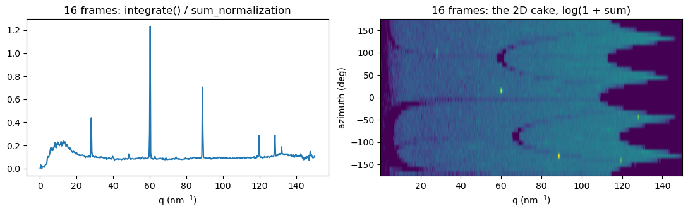

# Example 14: Frames and powder patterns on the GPU, handed to torch, jax, cupy, numba, pycuda and tensorflow

bslz4_to_sparse.cuda decodes on an NVIDIA GPU.  With the driver backend (BSLZ4_CUDA_BACKEND=driver)
it needs no CUDA toolkit, compiler or cupy: the kernels come compiled in the package (a fatbin with
code for every GPU generation from Fermi on) and are launched through the CUDA driver, libcuda, with
ctypes.  Two calls keep their results on the GPU:

    decompress(chunks)   the dense frames: (nframes, ni, nj) of the pixel dtype
    integrate(chunks)    each frame's powder, the sums of pyFAI's sparse matrix: (nframes, nbins)

The arrays they return follow the two conventions GPU libraries use to share memory,
__cuda_array_interface__ (cupy, numba, pycuda, torch) and DLPack (torch, jax, tensorflow, cupy), so
a library takes them without a copy: it works on the same GPU memory.  The data is complete when
the call returns.  This example gives the frames, a 1D powder pattern and a 2D (q x azimuth) cake
to each of these libraries that is installed, computes something there, and checks it against the
CPU (h5py's decompression and pyFAI's integration).  A library uses the device's primary context,
as the driver backend does (pycuda needs to be told: retain_primary_context).

Source: [`examples/ex14_gpu_libraries.py`](https://github.com/jonwright/bslz4_to_sparse/blob/main/examples/ex14_gpu_libraries.py), run as `python examples/ex14_gpu_libraries.py`, or download the [notebook](ex14_gpu_libraries.ipynb) (figures and output as run when this page was built).

Output, from running it on real data when this page was made: `silicon_u16_zstd2_256k.h5` of the example data ([https://doi.org/10.5281/zenodo.23361659](https://doi.org/10.5281/zenodo.23361659)) repacked as lz4 by `tools/example_data.py`, with its `mask.h5` and `tools/calib.poni`.  This page is committed, made by `tools/real_data_pages.py`; CI does not run it on this data.

```python
import os
```

```python
os.environ["BSLZ4_CUDA_BACKEND"] = "driver"  # set before bslz4_to_sparse.cuda is imported
os.environ.setdefault("XLA_PYTHON_CLIENT_PREALLOCATE", "false")  # jax: allocate as needed
os.environ.setdefault("TF_CPP_MIN_LOG_LEVEL", "3")  # tensorflow: errors only
```

```text
'3'
```

```python
import h5py
import hdf5plugin  # registers the bitshuffle filter, so that h5py can decompress too
import matplotlib.pyplot as plt
import numpy as np
import pyFAI
from pyFAI.method_registry import IntegrationMethod

from bslz4_to_sparse import cuda
```

```python
h5filename = "eiger_0000.h5"  # your file: bitshuffle-lz4 (8 kB blocks), one frame per chunk
h5dataset = "/entry_0000/ESRF-ID11/eiger/data"  # the (nframes, ni, nj) dataset inside it
mask_filename = (
    "mask.h5"  # your detector mask: a dataset "mask", pyFAI's convention (non-zero = masked)
)
poni_filename = "calib.poni"  # your pyFAI geometry
nframes = 16
```

```python
with h5py.File(h5filename, "r") as h5:
    ds = h5[h5dataset]
    dtype = ds.dtype
    n = min(nframes, ds.shape[0])
    chunks = [ds.id.read_direct_chunk((i, 0, 0))[1] for i in range(n)]
    frames = ds[:n]  # h5py's own decompression, on the CPU: the reference
with h5py.File(mask_filename, "r") as h5:
    bad = h5["mask"][()] != 0  # the masked pixels
mask = (~bad).astype(np.uint8)
```

pyFAI's sparse matrices (CSC), 1D and 2D, and their normalisation (an image of ones)

```python
ai = pyFAI.load(poni_filename)
ones = np.ones(frames.shape[1:], np.float32)
m1 = IntegrationMethod.select_one_available(("bbox", "csc", "cython"), dim=1)
m2 = IntegrationMethod.select_one_available(("bbox", "csc", "cython"), dim=2)
nq, nazim = 500, 36
norm1 = np.asarray(ai.integrate1d(ones, nq, unit="q_nm^-1", method=m1, mask=bad).sum_normalization)
ai.integrate2d(ones, nq, nazim, unit="q_nm^-1", method=m2, mask=bad)
engine1, engine2 = ai.engines[m1].engine, ai.engines[m2].engine
```

On the GPU: the frames, the 1D powder and the 2D cake of every frame

```python
gpu1 = cuda.chunk2sparseCSC(mask, engine1, dtype)
gpu2 = cuda.chunk2sparseCSC(mask, engine2, dtype)
d_frames = gpu1.decompress(chunks)  # (n, ni, nj) uint16
d_powder = gpu1.integrate(chunks)  # (n, nq) float64: sum of weight x pixel per bin
d_cake = gpu2.integrate(chunks)  # (n, nq * nazim) float64, q-major as pyFAI's matrix
print("GPU:", cuda.device_name(0))
print("GPU arrays:", d_frames.shape, d_frames.dtype, d_powder.shape, d_cake.shape)
ptr = d_frames.__cuda_array_interface__["data"][0]
assert (d_frames.get() == frames).all()  # .get(): a host copy, without any library
ref1 = ai.integrate1d(frames[0], nq, unit="q_nm^-1", method=m1, mask=bad)
ref2 = ai.integrate2d(frames[0], nq, nazim, unit="q_nm^-1", method=m2, mask=bad)
assert np.allclose(d_powder[:1].get()[0], ref1.sum_signal, rtol=1e-9, atol=0)
assert np.allclose(d_cake[:1].get()[0].reshape(nq, nazim).T, ref2.sum_signal, rtol=1e-9, atol=0)
print("frame 0 equals h5py's frame; its powder and cake equal pyFAI's sum_signal")
```

```text
GPU: NVIDIA L40S
GPU arrays: (16, 2162, 2068) uint16 (16, 500) (16, 18000)
frame 0 equals h5py's frame; its powder and cake equal pyFAI's sum_signal
```

```python
counts = np.count_nonzero((frames > 3) & ~bad, axis=(1, 2))  # pixels above 3, for numba below
host_cake = d_cake.get().reshape(n, nq, nazim)
results = {}  # library -> what it computed, for the summary
```

```python
def with_cupy():
    import cupy as cp

    x = cp.asarray(d_frames)  # __cuda_array_interface__: no copy
    assert x.data.ptr == ptr
    mean = x.mean(axis=0, dtype=cp.float64)  # the mean frame, on the GPU
    assert np.allclose(mean.get(), frames.mean(axis=0, dtype=np.float64))
    return "mean frame of %d, same memory" % n
```

```python
def with_torch():
    import torch

    p = torch.from_dlpack(d_powder)  # DLPack: no copy
    intensity = p / torch.as_tensor(norm1, device=p.device).clamp(min=1e-30)  # pyFAI's intensity
    assert np.allclose(intensity[0].cpu().numpy(), ref1.intensity, rtol=1e-6, atol=0)
    x = torch.as_tensor(d_frames, device="cuda")  # or __cuda_array_interface__
    assert x.data_ptr() == ptr
    return "normalised 1D patterns, (%d, %d), same memory" % tuple(intensity.shape)
```

```python
def with_jax():
    import jax
    import jax.numpy as jnp

    c = jax.dlpack.from_dlpack(d_cake).reshape(n, nq, nazim)  # DLPack: no copy
    spread = jnp.std(c, axis=2) / jnp.maximum(jnp.mean(c, axis=2), 1e-30)  # azimuthal variation
    want = host_cake.std(axis=2) / np.maximum(host_cake.mean(axis=2), 1e-30)
    assert np.allclose(np.asarray(spread), want, rtol=1e-6, atol=1e-9)
    return "azimuthal spread of each q bin, (%d, %d)" % spread.shape
```

```python
def with_numba():
    from numba import cuda as ncuda

    @ncuda.jit
    def count_above(fr, msk, cut, out):  # one thread per (frame, row): pixels above the cut
        f, i = ncuda.grid(2)
        if f < fr.shape[0] and i < fr.shape[1]:
            k = 0
            for j in range(fr.shape[2]):
                if fr[f, i, j] > cut and msk[i, j]:
                    k += 1
            ncuda.atomic.add(out, f, k)

    x = ncuda.as_cuda_array(d_frames)  # __cuda_array_interface__: no copy
    assert x.device_ctypes_pointer.value == ptr
    out = ncuda.to_device(np.zeros(n, np.int64))
    count_above[(n, (x.shape[1] + 127) // 128), (1, 128)](x, ncuda.to_device(mask), 3, out)
    assert (out.copy_to_host() == counts).all()
    return "a kernel of its own: pixels above 3 per frame"
```

```python
def with_pycuda():
    import pycuda.driver as drv
    import pycuda.gpuarray as gpuarray

    drv.init()
    ctx = drv.Device(0).retain_primary_context()  # the context the arrays live in
    ctx.push()
    try:
        x = gpuarray.GPUArray(d_frames.shape, d_frames.dtype, gpudata=ptr)  # no copy
        top = [int(gpuarray.max(x[i]).get()) for i in range(n)]
    finally:
        ctx.pop()
    assert top == [int(f.max()) for f in frames]
    return "brightest pixel of each frame"
```

```python
def with_tensorflow():
    import tensorflow as tf

    for g in tf.config.list_physical_devices("GPU"):
        tf.config.experimental.set_memory_growth(g, True)
    x = tf.experimental.dlpack.from_dlpack(d_frames.__dlpack__())  # DLPack: no copy
    total = tf.reduce_sum(tf.cast(x, tf.float64), axis=(1, 2)).numpy()
    assert np.allclose(total, frames.sum(axis=(1, 2), dtype=np.float64))
    return "sum of each frame"
```

```python
for name, fn in [("cupy", with_cupy), ("torch", with_torch), ("jax", with_jax),
                 ("numba", with_numba), ("pycuda", with_pycuda), ("tensorflow", with_tensorflow)]:
    try:
        __import__(name)
    except ImportError:
        results[name] = "not installed"
        continue
    results[name] = fn()
for name, what in results.items():
    print("%-10s %s" % (name, what))
```

```text
cupy       mean frame of 16, same memory
torch      normalised 1D patterns, (16, 500), same memory
jax        azimuthal spread of each q bin, (16, 500)
numba      a kernel of its own: pixels above 3 per frame
pycuda     brightest pixel of each frame
tensorflow sum of each frame
```

The other direction: chunks already in GPU memory, as a GPUDirect Storage read (kvikio, cuFile)
would leave them, one buffer with the chunks at known offsets.  Here a copy made by one of the
libraries stands in for that read.  *_from_device read the chunks in place: nothing goes back to
the host, and the chunk headers are checked on the GPU.

```python
lengths = np.array([len(c) for c in chunks], np.int64)
offsets = np.concatenate(([0], np.cumsum(lengths)[:-1]))
blob = np.frombuffer(b"".join(chunks), np.uint8)
d_chunks = None
if results.get("cupy") != "not installed":
    import cupy as cp

    d_chunks = cp.asarray(blob)
elif results.get("torch") != "not installed":
    import torch

    d_chunks = torch.from_numpy(blob.copy()).cuda()
if d_chunks is not None:
    d_powder2 = gpu1.integrate_from_device(d_chunks, offsets, lengths)
    assert (d_powder2.get() == d_powder.get()).all()
    assert (gpu1.decompress_from_device(d_chunks, offsets, lengths).get() == frames).all()
    print("chunks in a %s GPU buffer: integrate_from_device and decompress_from_device give the "
          "same results" % type(d_chunks).__module__.split(".")[0])
```

```text
chunks in a cupy GPU buffer: integrate_from_device and decompress_from_device give the same results
```

The 1D pattern and the cake of all the frames, as the GPU gave them

```python
q, chi = ref2.radial, ref2.azimuthal
fig, axes = plt.subplots(1, 2, figsize=(11, 3.5))
axes[0].plot(ref1.radial, d_powder.get().sum(axis=0) / np.maximum(norm1, 1e-30))
axes[0].set_xlabel("q (nm$^{-1}$)")
axes[0].set_title("%d frames: integrate() / sum_normalization" % n)
axes[1].imshow(np.log1p(host_cake.sum(axis=0).T), aspect="auto", origin="lower",
               extent=(q[0], q[-1], chi[0], chi[-1]))
axes[1].set_xlabel("q (nm$^{-1}$)")
axes[1].set_ylabel("azimuth (deg)")
axes[1].set_title("%d frames: the 2D cake, log(1 + sum)" % n)
plt.tight_layout()
plt.show()
```



<small>Generated by `tools/real_data_pages.py` from bslz4_to_sparse 0.0.22a1 (git `v0.0.21a1-95-g1f20569`, sources sha256 `6929bd75ab7a`).</small>
